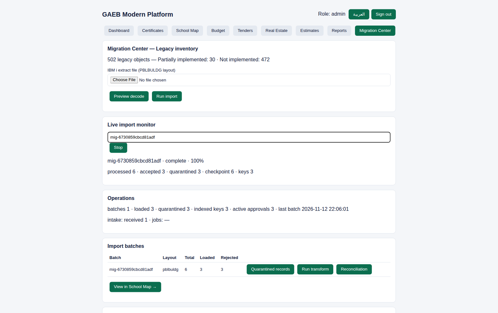

# GAEB Modern Platform

Modernization of the Egyptian **General Authority for Educational Buildings
(GAEB)** legacy system — an IBM i / AS/400 application (V6R1, library
NEWLIBGAEB) covering school buildings, budgets, tenders, payment certificates,
estimates and real estate — rebuilt as a standalone, bilingual (English /
Arabic, full RTL) platform on PostgreSQL, with an evidence-grade migration
engine for the legacy data.

Built by Veebase LLC from the legacy system's own source listings: 502 source
members, 169 data files, 125 physical files, 1,068 reconciled fields, 333
programs, six subsystems.



More screens — every module, in English and Arabic: **[docs/SCREENSHOTS.md](docs/SCREENSHOTS.md)**

## The two codebases in this repository

| | What it is |
|---|---|
| `platform/` | **The production system.** Standalone Node.js/TypeScript API + React frontend on PostgreSQL. No dependency on any hosted runtime. Start with [`platform/README.md`](platform/README.md). |
| `client/`, `server/`, `drizzle/` | The original proof-of-concept web app, kept for reference. The production work supersedes it. |
| `migration/` | The migration package generated from the AS/400 source: parser, DDL generator, reconciled schema v2 (126 staging tables), 1,068-field mapping register, coverage matrix for all 502 legacy objects, and the modernization blueprint. |

## What the platform does

- **Six business modules** with their real workflows: School Map (building
  registry), Budget, Purchases & Contracts (tender stage machine), Payment
  Certificates (exact-decimal valuation, typed deductions, separation of
  duties), Estimates/BOQ (catalogue-driven, revisioned approvals), Real
  Estate (expropriation decree gate).
- **A migration engine built for evidence, not demos.** Offline extracts only
  — the platform never writes to the source IBM i. Native EBCDIC binary,
  fixed-text and delimited formats; per-field CCSID decoding (IBM 420/864,
  Windows-1256) with originals preserved; packed/zoned decimal decoding;
  deterministic batch ids and an append-only run ledger, so a retry is a
  no-op, never a double count; byte-level quarantine for every reject with
  audited resubmission; streaming imports with O(1) checkpoints and a key
  index (2M+ records at ~4,500–5,400 records/second in sandbox benchmarks).
- **Governed transforms.** Staging data becomes operational data only through
  mapping approvals bound to an authenticated approver, the batch's data class
  (a demo approval can never authorize customer data) and the current
  transform definition hash.
- **Reconciliation that keeps three questions separate:** did the bytes
  reconcile (technical), does the business agree (equivalence), has the
  customer accepted (acceptance) — each reported on its own evidence.
- **Security as shipped code:** scrypt password hashing, revocable sessions,
  RBAC with separation of duties, login throttling, correlation ids, security
  headers, a full audit log — and no seeded accounts anywhere.

## Quick start

```bash
docker compose up --build     # PostgreSQL + API (:8080) + frontend (:5173)
docker compose exec api node dist/src/cli/create-admin.js
```

Native run, tests (65 tests against real PostgreSQL), and operator tooling
(preflight validator, benchmarks, backup/restore, PITR drill, health check,
SBOM) are documented in [`platform/README.md`](platform/README.md).

## Verified status — kept honest on purpose

| Area | Status |
|---|---|
| Engineering implementation & PostgreSQL integration | **Verified** — 65/65 tests, 0 skipped |
| Migration engine (synthetic extracts, to 2M records) | **Verified** |
| Backup / restore / point-in-time recovery | **Verified** (logical, physical, PITR drill) |
| Docker deployment | **Not verified** — compose validated; the smoke suite awaits an authorized CI credential (see `docs/phase8/GITHUB_CICD_AUDIT.md`) |
| CI enforcement | **Blocked** — the repository token lacks the GitHub `workflow` scope; validated workflows are staged in `ci/` |
| Migration of actual GAEB data | **Blocked** — no extracts received yet |
| Business equivalence with the legacy system | **Not verified** — 8 decisions await GAEB (`docs/validation/GAEB_Business_Decision_Register.md`) |
| Customer UAT / production authorization | **Not started** — packages ready, awaiting GAEB participants and sign-off |

The full gate history, evidence and open blockers live in `docs/`
(`BLOCKERS.md`, `MILESTONE_REPORT.md`, `evidence/` per phase). Statuses in
this repository are only ever claimed with executed evidence behind them.

## Documentation map

- `docs/ARCHITECTURE.md`, `docs/ARABIC.md`, `docs/FINANCE.md`, `docs/SECURITY.md` — design records
- `docs/customer/` — the data-request pack GAEB's IBM i team works from (EN/AR)
- `docs/pilot-package/` — configuration, monitoring, go/no-go for the customer pilot
- `docs/uat/` — UAT plan, 30 customer cases, sign-off templates
- `docs/validation/` — equivalence methodology, business-rule and decision registers
- `docs/release/` — deployment, rollback and operations runbooks, readiness reviews
- `docs/delivery/` — the customer acceptance dossier

## Legacy estate at a glance

502 source members · 169 data files (135 PF + 34 LF) · 125 distinct physical
files · 1,068 reconciled unique fields · 333 programs (270 RPG) · subsystems:
School Map, Budget, Purchases & Contracts, Technical Abstracts (payment
certificates), Estimates (BOQ), Real Estate.
