# Screenshots

All screenshots were captured on 2026-11-12 from the **production platform**
(`platform/`) running against PostgreSQL with **synthetic demonstration data
only** — no GAEB customer data. The Migration Center state is real: a binary
IBM 420 extract was imported through the platform's own API before capture, so
the batch, quarantine, approvals and live-monitor figures are genuine system
output, not mock-ups.

## Sign in
Role-based access with scrypt-hashed passwords, opaque revocable sessions and
login throttling. There are no seeded accounts in production; the first admin
is created with a CLI command.

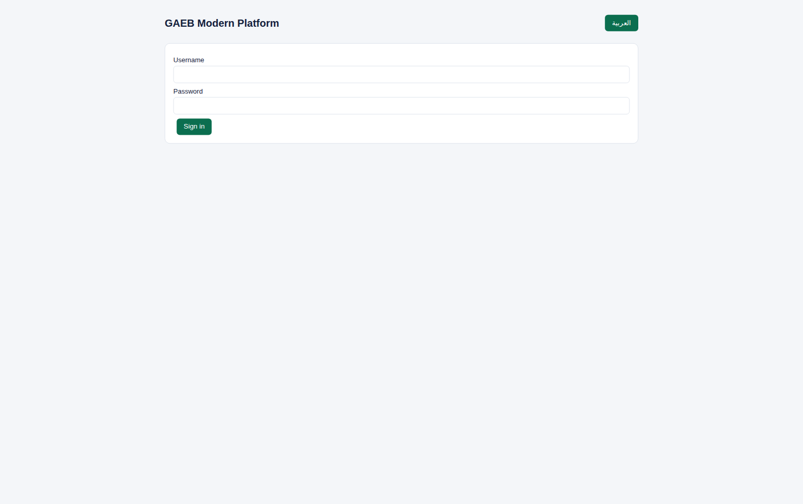

## Dashboard (English)
Portfolio counts across the operational modules.

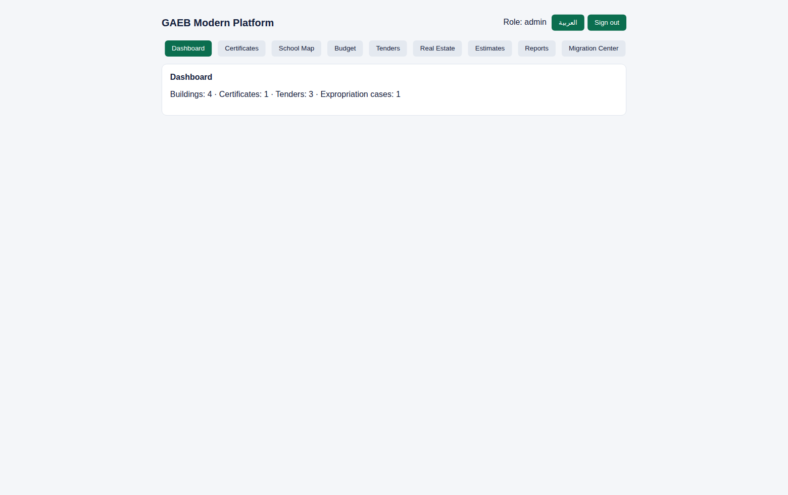

## Dashboard (Arabic, full RTL)
Arabic is a first-class interface language with complete right-to-left layout,
not a translation overlay.

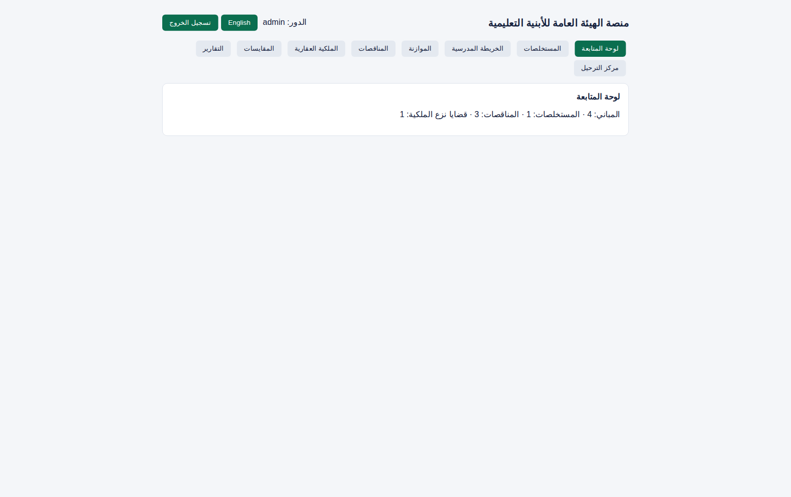

## School Map — building registry
The shared foundation of all six subsystems: the building register keyed by
the legacy BLCD code, with Arabic names preserved exactly as migrated.

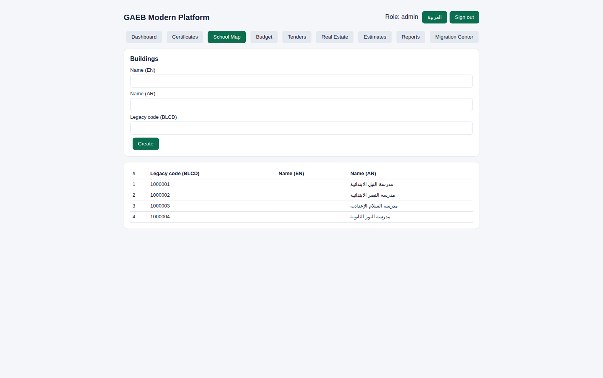

## Budget
Allocations against the building register. (The Budget *migration transform*
remains blocked pending the legacy PBA3* master-file definitions — see
`docs/BLOCKERS.md`, B-01.)

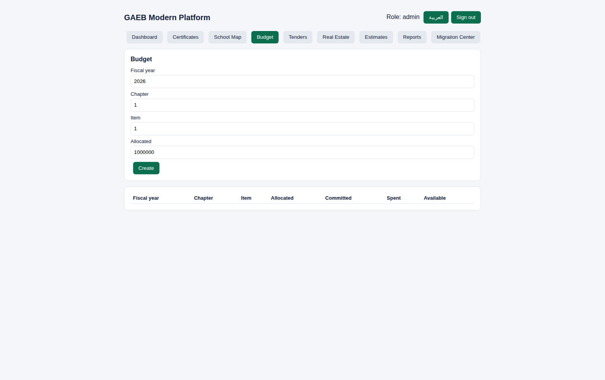

## Tenders (Purchases & Contracts)
The Egyptian tender lifecycle as an enforced stage machine — announced →
documents → offers → evaluation → awarded — with no skipped stages.

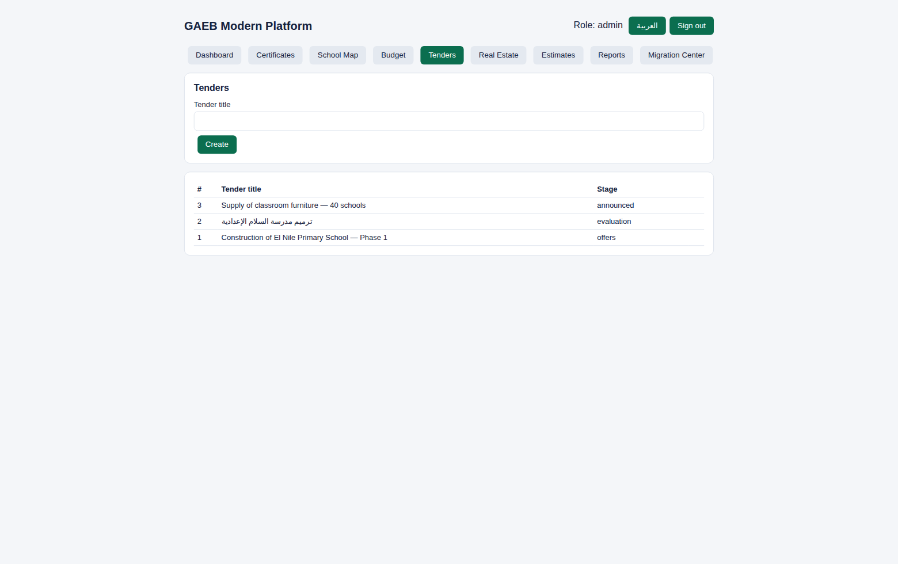

## Payment Certificates (Technical Abstracts)
Certificate chain with exact decimal valuation (quantity × price, typed
deductions) and separation of duties: the certifier cannot authorize payment.

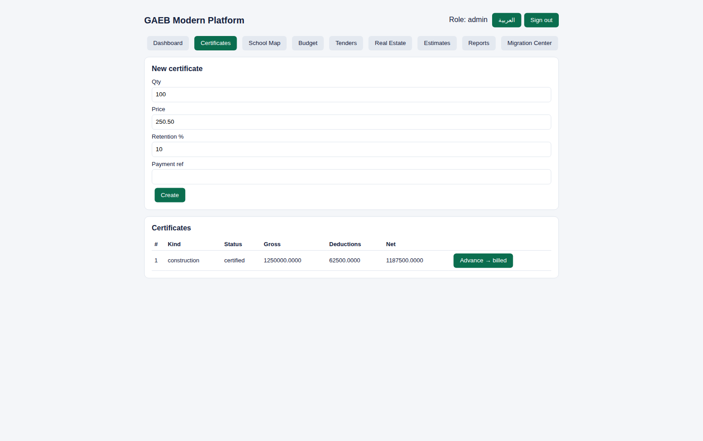

## Estimates / BOQ
Catalogue-driven estimates — an item that is not in the approved catalogue
cannot be added — with a draft → reviewed → approved workflow and
return-for-correction revisions.

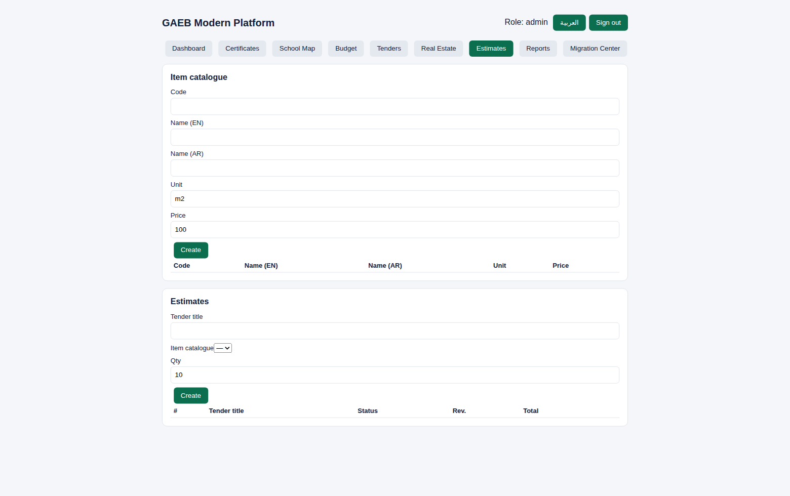

## Real Estate
Lands, leases and expropriation cases; a case advances from REMV01 to REMV02
only after the ministerial decree is recorded.

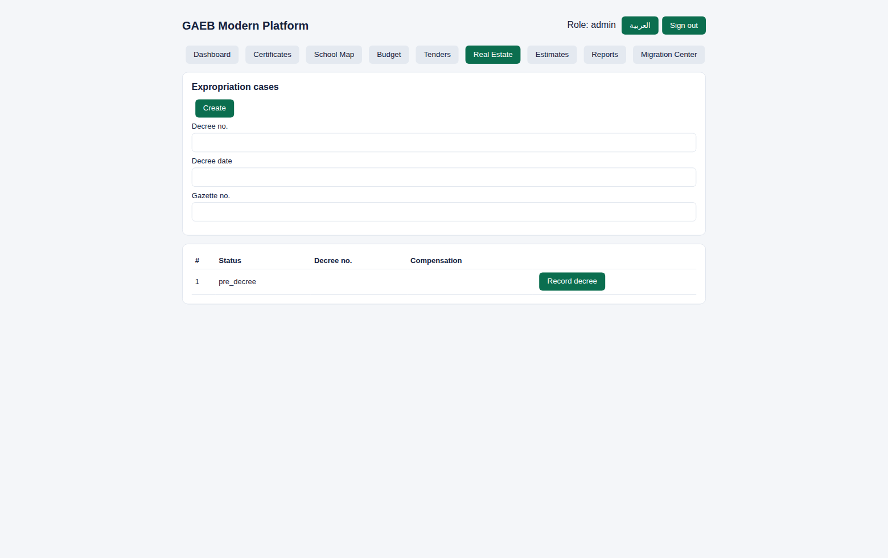

## Migration Center
The control room for the AS/400 migration: the 502-object legacy inventory
with honest coverage, extract import (binary EBCDIC, fixed-text and delimited
formats), the **live import monitor** (progress, checkpoint, indexed keys —
here showing a completed batch: 6 processed, 3 accepted, 3 quarantined), the
operations strip, import batches with quarantine inspection and reconciliation,
and the governed intake pipeline.

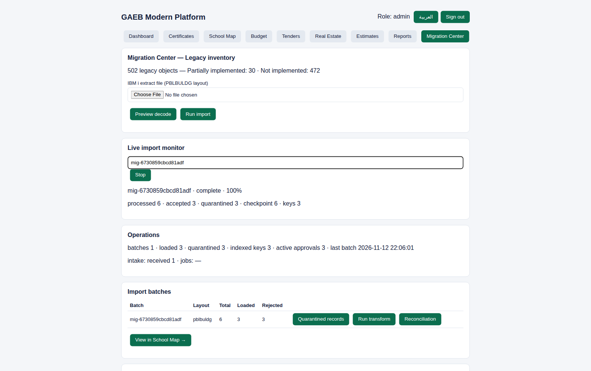

## Migration Center (Arabic)
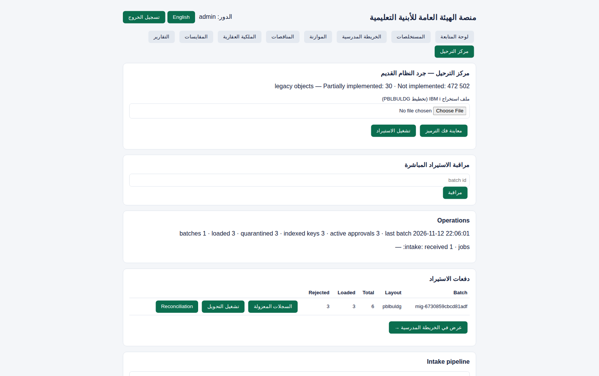

## Reports
Finance and operational reports as authenticated CSV downloads, gated by the
`reports.finance` permission.

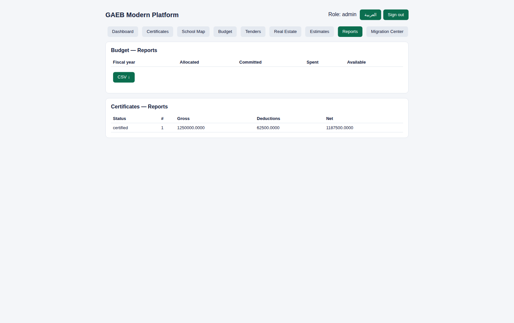

## Reproducing these screenshots
1. Create a database and apply `platform/migrations/001–009` plus
   `migration/reconciled/schema_v2.sql`.
2. Create users with `platform` CLI conventions (scrypt hashes; no defaults).
3. Start the API (`DATABASE_URL=… node dist/src/server.js`) and the frontend
   (`npm run build` in `platform/frontend`, serve with `API_PROXY` set).
4. Optionally import the demo PBLBULDG extract through the Migration Center to
   populate the batch, operations and live-monitor panels.
